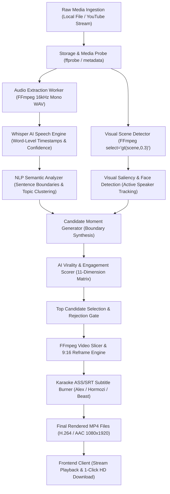

# Multimodal AI Video Repurposing Architecture

**Document Version**: 2.0.0  
**Target Capabilities**: OpusClip & Vizard.ai Parity  
**Author**: Senior AI Product Architect & Multimodal Systems Engineer

---

## 1. System Architecture Overview



---

## 2. Ingestion & Storage Architecture

### A. Dual Ingestion Pathways
1. **Direct File Upload (`multipart/form-data`)**:
   - Streamed via `multer` directly to local staging directory (`server/uploads/`).
   - Validated via `ffprobe` for valid container, video codec (H.264, HEVC, VP9, AV1), audio stream presence, and duration.
2. **Online Stream URL Ingestion (YouTube, Twitch, VODs)**:
   - Extracted using standard stream extraction or `yt-dlp` into local stream container.
   - Probed for resolution, fps, bitrate, and duration.

### B. Persistent Directory Layout
```
server/
├── uploads/             # Raw ingested source video files
├── audio/               # Extracted 16kHz mono WAV files for Whisper
├── transcripts/         # JSON transcripts with word-level timestamps
├── subtitles/           # Generated .ass / .srt subtitle files
└── outputs/             # Final rendered 9:16 short MP4 video files
```

---

## 3. Multimodal Understanding Pipeline

### A. Audio Understanding & Speech Recognition
- **Audio Extraction**:
  `ffmpeg -y -i input.mp4 -vn -acodec pcm_s16le -ar 16000 -ac 1 audio.wav`
- **Whisper Speech-to-Text**:
  - Model: OpenAI Whisper / Faster-Whisper / Transformers.js.
  - Generates words with exact `start` and `end` floating-point seconds.
  - Captures pauses (`end[i] - start[i+1] > 0.6s`), filler words (`uh`, `um`, `like`), and voice activity energy.

### B. Transcript Semantic Understanding & Candidate Discovery
1. **Boundary Synthesis**:
   - Instead of slicing at fixed timestamps (e.g. 0 to 60s), boundaries are formed at complete grammatical and narrative units (sentence ends, paragraph pauses, question-answer transitions).
2. **Hook Identification**:
   - The first 3 seconds of any candidate must contain a strong rhetorical hook (controversial question, emotional trigger, counter-intuitive insight, high word energy).
3. **Context Preservation**:
   - Ensures an explanation is not cut off before the punchline or conclusion is reached. Minimum candidate length: 20s; Maximum candidate length: 90s.

### C. Visual Scene Analysis
- **Scene Change Detection**:
  `ffmpeg -i input.mp4 -filter_complex "select='gt(scene,0.3)',metadata=print:file=scenes.txt" -f null -`
- Identifies visual transitions and camera switches, ensuring video cuts do not occur mid-motion.

---

## 4. AI Candidate Scoring Matrix (11 Dimensions)

Every candidate moment is evaluated against 11 weighted metrics:

| Dimension | Weight | Evaluation Criteria |
| :--- | :---: | :--- |
| **Hook Strength** | 20% | Provocative opening sentence, emotional shock, question within 0–3s |
| **Story Completeness** | 15% | Has distinct premise, build-up, and satisfying resolution |
| **Independent Watchability** | 15% | Understandable without seeing the rest of the 2-hour video |
| **Emotional Engagement** | 10% | Passionate delivery, humor, suspense, or inspirational tone |
| **Information Density** | 10% | Actionable takeaway, unique knowledge, memorable insight |
| **Pacing & Flow** | 10% | Words-per-minute (140-180 wpm optimal for TikTok/Reels) |
| **Clarity of Speech** | 5% | Low background noise, high Whisper transcription confidence |
| **Visual Interest** | 5% | Scene movement, visual subject focus, expressive gestures |
| **Redundancy Penalty** | -10% | Penalizes repeated topics across candidates |
| **Silence / Stumble Penalty**| -10% | Penalizes prolonged awkward silence or excessive fillers |
| **Abrupt Cut Penalty** | -15% | Penalizes sentences chopped in half mid-thought |

**Quality Threshold Gate**:
- Candidates scoring below `65/100` are **rejected** by the AI engine. The engine only surfaces high-potential viral candidates.

---

## 5. Clip Modes & Strategies

1. **Best Moments (General)**: Highest cumulative virality and independent watchability.
2. **Podcast / Interview**: Focuses on question-and-answer pairs; tracks speaker conversational turns.
3. **Education / Explainer**: Prioritizes step-by-step logic, definitions, and "how-to" demonstrations.
4. **Storytelling**: Identifies narrative pacing with personal anecdotes and climax resolutions.
5. **Gaming / Action**: Uses visual scene velocity and elevated audio energy peaks.
6. **Vlogs**: Visual-first sequences with engaging narration.
7. **Custom Prompt Search**: Semantic cosine similarity between user prompt and candidate transcripts.
8. **Full Video Search**: Topic-based keyword and conceptual search indexing across the entire VOD.

---

## 6. Real Video Rendering Engine (FFmpeg)

### 9:16 Vertical Video Reframing Strategy
When converting 16:9 landscape to 9:16 vertical short format, we use an automated dual-layer filter pipeline:
1. **Background Layer**: 16:9 video scaled and cropped to 1080x1920 with a 25px Gaussian blur (`boxblur=25:5`).
2. **Foreground Layer**: Scaled original aspect ratio, centered with drop-shadow.
3. **Subtitles**: ASS formatted styled subtitles burned directly onto the video canvas with word-by-word karaoke highlight colors.

```bash
ffmpeg -y -ss {START} -to {END} -i input.mp4 \
  -filter_complex "[0:v]scale=1080:1920:force_original_aspect_ratio=increase,crop=1080:1920,boxblur=25:5[bg]; \
                   [0:v]scale=1080:-1[fg]; \
                   [bg][fg]overlay=(W-w)/2:(H-h)/2[v]" \
  -map "[v]" -map 0:a? \
  -c:v libx264 -preset fast -crf 22 -c:a aac -b:a 192k \
  output_clip.mp4
```

---

## 7. Job Queue & Storage Lifecycle

1. **Asynchronous Processing**:
   - HTTP POST `/api/process` returns immediately with a `jobId`.
   - Client polls `/api/jobs/:id` or subscribes via Server-Sent Events (SSE).
2. **State Persistence**:
   - Job metadata stored in persistent JSON/SQLite store with status (`queued`, `extracting_audio`, `transcribing`, `ranking`, `rendering`, `completed`, `failed`).
   - If the user reloads the browser, the job continues uninterrupted in the background.
